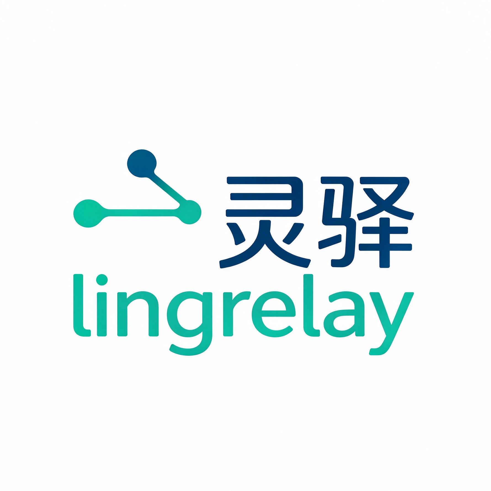

<div align="center">



# LingRelay

**OpenAI 兼容的 LLM API 中继服务**

[](https://lingrelay.xyz)
[](https://lingrelay.xyz/v1)

</div>

---

## 📖 概述

LingRelay 是一个提供 **OpenAI 兼容接口** 的 LLM API 中继服务，支持多种主流模型，可通过标准 OpenAI SDK / curl / 任意 OpenAI 兼容客户端直接调用。

- **Base URL**: `https://lingrelay.xyz/v1`
- **认证方式**: `Authorization: Bearer sk-xxxxxxxx`（在后台生成 API Key）
- **响应格式**: JSON（OpenAI Chat Completions 规范）
- **流式支持**: ✅ SSE (`stream: true`)

---

## 🤖 可用模型

| 模型 ID | 说明 | 适用场景 |
|---|---|---|
| `deepseek-chat` | DeepSeek 对话模型 | 通用对话、问答 |
| `deepseek-coder` | DeepSeek 代码模型 | 代码生成、重构、Debug |
| `deepseek-v4.1-flash` | DeepSeek 快速版 | 低延迟场景 |
| `glm-5.3-flash` | 智谱 GLM 快速版 | 中文任务、低成本场景 |

> 模型列表以 `GET /v1/models` 实际返回为准。

---

## 🚀 快速开始

### 1. 获取 API Key

访问 [https://lingrelay.xyz](https://lingrelay.xyz) → 注册/登录 → **令牌** → **添加令牌** → 复制 `sk-` 开头的 Key。

### 2. 用 curl 测试

```bash
curl https://lingrelay.xyz/v1/chat/completions \
  -H "Content-Type: application/json" \
  -H "Authorization: Bearer sk-你的Key" \
  -d '{
    "model": "deepseek-chat",
    "messages": [
      {"role": "user", "content": "你好"}
    ]
  }'
```

### 3. 用 Python (openai SDK)

```python
from openai import OpenAI

client = OpenAI(
    api_key="sk-你的Key",
    base_url="https://lingrelay.xyz/v1"
)

response = client.chat.completions.create(
    model="deepseek-chat",
    messages=[{"role": "user", "content": "你好"}]
)
print(response.choices[0].message.content)
```

### 4. 用 Node.js (openai SDK)

```javascript
import OpenAI from "openai";

const client = new OpenAI({
  apiKey: "sk-你的Key",
  baseURL: "https://lingrelay.xyz/v1"
});

const res = await client.chat.completions.create({
  model: "deepseek-chat",
  messages: [{ role: "user", content: "你好" }]
});
console.log(res.choices[0].message.content);
```

---

## 🌊 流式响应（SSE）

```python
stream = client.chat.completions.create(
    model="deepseek-chat",
    messages=[{"role": "user", "content": "讲个故事"}],
    stream=True
)

for chunk in stream:
    if chunk.choices[0].delta.content:
        print(chunk.choices[0].delta.content, end="")
```

---

## ⚙️ 限制与配额

| 项 | 值 |
|---|---|
| 全局速率上限 | ~1000 请求/分钟 |
| 单令牌速率 | 后台令牌设置里可调 |
| 并发连接 | 单 IP 30 条 |
| 超时 | 300 秒 |
| 单次请求最大上下文 | 由具体模型决定 |

---

## 🔌 兼容端点

| 端点 | 方法 | 说明 |
|---|---|---|
| `/v1/models` | GET | 列出所有可用模型 |
| `/v1/chat/completions` | POST | 对话补全（支持 stream） |
| `/v1/completions` | POST | 文本补全（部分模型支持） |
| `/v1/embeddings` | POST | 向量化（视渠道而定） |

---

## 🛠️ 常见错误

| 状态码 | 含义 | 处理建议 |
|---|---|---|
| 401 | API Key 无效或过期 | 后台重新生成 |
| 404 | 模型 ID 不存在 | 用 `/v1/models` 查询实际可用列表 |
| 429 | 触发速率限制 | 降低请求频率，或联系管理员 |
| 500 | 上游异常 | 重试，若持续发生请反馈 |

---

## 📮 联系方式

- **后台**: https://lingrelay.xyz
- **问题反馈**: [GitHub Issues](../../issues)

---

<div align="center">
<sub>Powered by done-hub · OpenAI-Compatible LLM Relay</sub>
</div>
